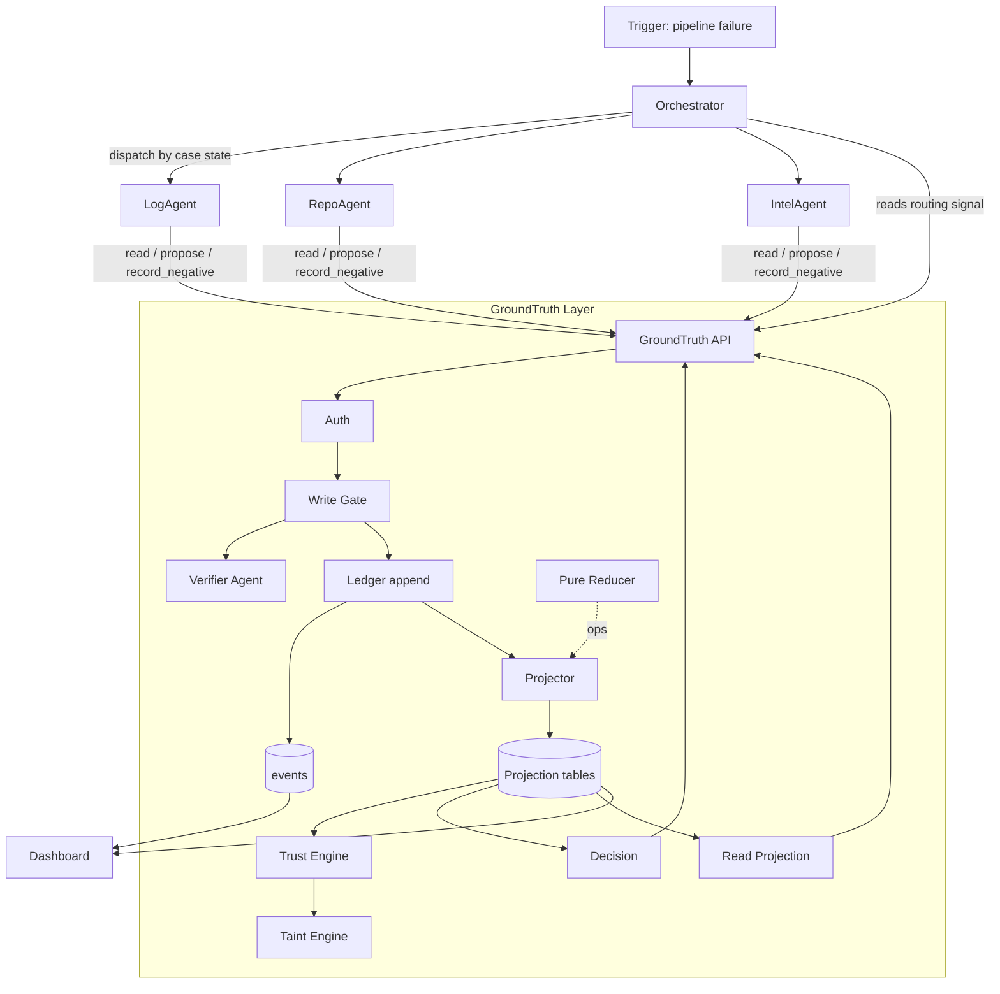
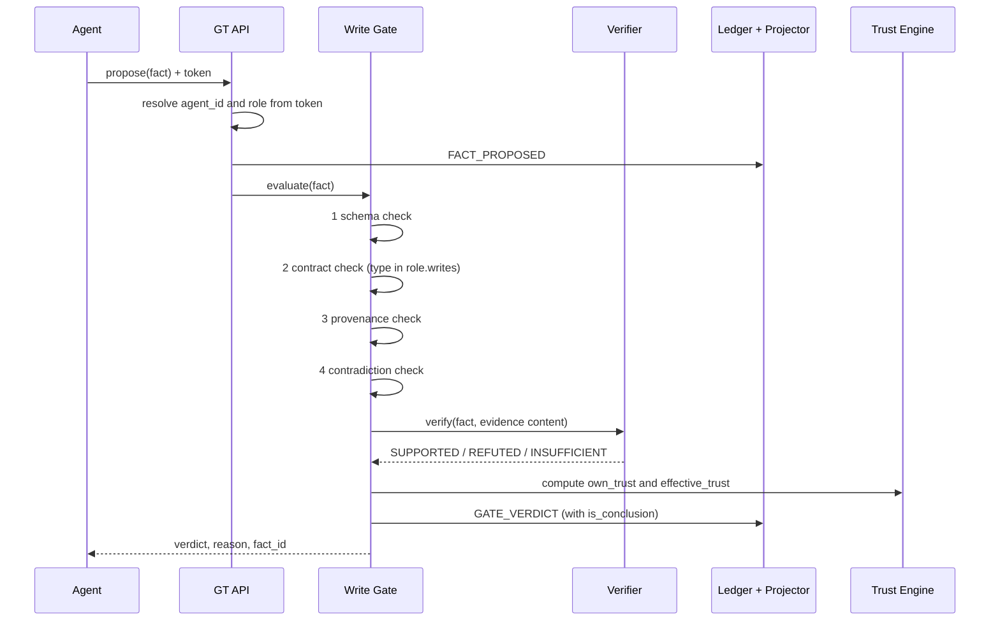

# GROUNDTRUTH: Architecture

*Companion to the GROUNDTRUTH PRD. The PRD says what and why. This document says how.*

**Status:** Draft for build, revision 2.1. Numeric defaults (trust values, thresholds, timeouts, budgets) are proposals to be tuned on the fixtures, not measured results. This revision closes eight gaps found when auditing against `rules.md` (see Appendix A for the change log) and settles four previously open decisions (section 19). Revision 2.1 fixes the problems found in a final read-through (Appendix A, F1 to F9).

---

## 1. Scope and Design Principles

| # | Principle | Consequence in the design |
|---|---|---|
| 1 | Agents propose, the layer decides | No agent has a write path to the store. All writes go through the Write Gate. |
| 2 | The ledger is the truth, state is derived | The `cases`, `facts`, `fact_edges`, and `negative_checks` tables are projections, rebuilt by a pure reducer over ledger events. |
| 3 | Fail closed | Any timeout or error in verification results in QUARANTINE, never ADMIT. |
| 4 | Rules decide, LLMs advise | Trust, conflicts, taint, budget, and escalation are deterministic code. The LLM is used only by agents and by the Verifier, and the Verifier's strict-JSON verdict is data that deterministic code maps to gate verdicts and trust caps. |
| 5 | One datastore | SQLite (demo) or Postgres holds everything durable. No graph DB. In-process memory (the Verifier cache) is not a datastore. |
| 6 | Identity comes from the caller, not the payload | `agent_id` and `role` are derived from the authenticated token. |
| 7 | One writer for projections | Only `core/projector.py` writes the projection tables, and only by executing operations the pure reducer derived from a ledger event. |

---

## 2. System Context



**Boundaries**

| Component | Owns | Does not own |
|---|---|---|
| Orchestrator | Dispatch, retries, escalation action, case state transitions | Facts, trust, or any case state |
| Agents | Reasoning and tool calls, stateless between runs | Writing to the store |
| GroundTruth API | Request routing | Business rules |
| Auth | Token resolution, case scoping, access-denied logging | Contract contents |
| Write Gate | Admission verdicts | Trust values (delegates to the trust engine) |
| Verifier | One falsification attempt per proposal | Final verdict (the gate maps its output) |
| Reducer | Pure derivation of operations from `(state, event)` | Any I/O |
| Projector | The only SQL writes to projection tables, inside the ledger transaction | Deciding what to write (the reducer does) |
| Trust, Taint, Decision | Computed trust, taint propagation, `/decision` signal | Contract checks |
| Dashboard | Read-only rendering | Any mutation, except human override events |

---

## 3. Technology Choices

| Layer | Choice | Reason |
|---|---|---|
| Language | Python 3.11+ | Fastest for a hackathon team |
| API | FastAPI + Pydantic | Schema validation for free, auto-generated docs |
| Storage | SQLite for demo, Postgres if multi-process | One DB for ledger, projections, contracts, tokens |
| Graph traversal | In-memory Python over `fact_edges` | Case graphs are tens of nodes, not millions |
| LLM access | Thin adapter interface (`complete(prompt) -> text`) | Swap providers without touching the layer |
| Verifier cache | In-process dict with LRU bound | Fixture-identical claims only. Lost on restart by design. Not a datastore, not shared between processes |
| Orchestration | Small custom router, or LangGraph if the team already knows it | Orchestrator is deliberately thin |
| Dashboard | React or a simple HTMX/Jinja page, with Server-Sent Events | Live verdict stream with little code |
| Hashing | SHA-256 over canonical JSON | Ledger hash chain |

---

## 4. Data Architecture

### 4.1 Schema (SQLite-compatible)

```sql
-- PROJECTION: rebuilt by replay (INV-2). Written only by projector.py (INV-3).
CREATE TABLE cases (
  case_id        TEXT PRIMARY KEY,
  domain_pack    TEXT NOT NULL,
  trigger        TEXT NOT NULL,          -- JSON
  state          TEXT NOT NULL CHECK (state IN ('OPEN','INVESTIGATING','CONCLUDED','CLOSED')),
  opened_at      TEXT NOT NULL,
  concluded_at   TEXT,
  conclusion_fact_id TEXT                -- set by the reducer on an admitted conclusion (section 4.2)
);

CREATE TABLE events (                    -- append-only (INV-1)
  event_id       TEXT PRIMARY KEY,
  case_id        TEXT NOT NULL,          -- no foreign key: cases is a projection built from these events
  seq            INTEGER NOT NULL,       -- per-case, gapless, starts at 1
  event_type     TEXT NOT NULL,
  actor          TEXT NOT NULL,
  payload        TEXT NOT NULL,          -- canonical JSON
  prev_hash      TEXT NOT NULL,
  hash           TEXT NOT NULL,
  ts             TEXT NOT NULL,
  UNIQUE (case_id, seq)
);

-- INV-1: the table definition alone does not stop UPDATE or DELETE (tested), so enforce it.
CREATE TRIGGER events_no_update BEFORE UPDATE ON events
BEGIN SELECT RAISE(ABORT, 'INV-1: events is append-only'); END;
CREATE TRIGGER events_no_delete BEFORE DELETE ON events
BEGIN SELECT RAISE(ABORT, 'INV-1: events is append-only'); END;

-- Access attempts that cannot be placed in a case ledger: unknown or expired token,
-- unknown case, or a CLOSED case (SEC-5). Never stores fact contents.
CREATE TABLE access_log (                -- append-only (INV-1)
  log_id         TEXT PRIMARY KEY,
  ts             TEXT NOT NULL,
  caller         TEXT,                   -- first 8 chars of the token hash, or NULL if no token
  target_case_id TEXT,
  endpoint       TEXT NOT NULL,
  reason         TEXT NOT NULL
);
CREATE TRIGGER access_log_no_update BEFORE UPDATE ON access_log
BEGIN SELECT RAISE(ABORT, 'INV-1: access_log is append-only'); END;
CREATE TRIGGER access_log_no_delete BEFORE DELETE ON access_log
BEGIN SELECT RAISE(ABORT, 'INV-1: access_log is append-only'); END;

CREATE TABLE facts (                     -- PROJECTION
  fact_id        TEXT PRIMARY KEY,
  case_id        TEXT NOT NULL,
  type           TEXT NOT NULL,
  value          TEXT NOT NULL,          -- JSON
  source         TEXT NOT NULL,
  source_type    TEXT NOT NULL CHECK (source_type IN ('tool_output','document','agent_inference','human_input')),
  agent_id       TEXT NOT NULL,
  created_at     TEXT NOT NULL,
  self_confidence REAL NOT NULL CHECK (self_confidence BETWEEN 0 AND 1),
  own_trust      REAL NOT NULL,
  effective_trust REAL NOT NULL,
  evidence_ref   TEXT,
  status         TEXT NOT NULL CHECK (status IN ('ACTIVE','CONTESTED','QUARANTINED','RETRACTED','TAINTED')),
  verifier_state TEXT NOT NULL DEFAULT 'NOT_SUPPORTED' CHECK (verifier_state IN ('SUPPORTED','NOT_SUPPORTED','DOWNGRADED')),
  entity_key     TEXT,                   -- used for contradiction checks, e.g. 'pipeline.root_cause'
  volatile       INTEGER NOT NULL DEFAULT 0,
  is_conclusion  INTEGER NOT NULL DEFAULT 0   -- fact type equals the pack's conclusion_type
);

CREATE TABLE fact_edges (                -- PROJECTION: derived_from, child -> parent
  child_id       TEXT NOT NULL REFERENCES facts(fact_id),
  parent_id      TEXT NOT NULL REFERENCES facts(fact_id),
  PRIMARY KEY (child_id, parent_id)
);

CREATE TABLE negative_checks (           -- PROJECTION: negative knowledge
  check_id       TEXT PRIMARY KEY,
  case_id        TEXT NOT NULL,
  fact_id        TEXT NOT NULL REFERENCES facts(fact_id),
  check_type     TEXT NOT NULL,          -- e.g. 'oom_killed'
  scope          TEXT NOT NULL,          -- JSON array of entities checked, e.g. pod names (NEG-1)
  window_start   TEXT NOT NULL,          -- NEG-1: a window is mandatory
  window_end     TEXT NOT NULL,
  expires_at     TEXT                    -- NULL means the record does not expire
);

CREATE TABLE contracts (                 -- config, seeded from the pack (not a projection)
  role           TEXT PRIMARY KEY,
  reads          TEXT NOT NULL,          -- JSON array of fact types, or ["*"] for reserved roles
  writes         TEXT NOT NULL,          -- JSON array of fact types
  max_context_tokens INTEGER NOT NULL,
  min_trust_threshold REAL NOT NULL
);

CREATE TABLE agent_tokens (              -- config
  token_hash     TEXT PRIMARY KEY,
  agent_id       TEXT NOT NULL,
  role           TEXT NOT NULL REFERENCES contracts(role),
  case_id        TEXT NOT NULL           -- tokens are case-scoped
);
```

### 4.2 Event types and payloads

| Event | Payload (summary) | Reducer effect |
|---|---|---|
| `CASE_OPENED` | pack, full trigger | Insert case (state OPEN) |
| `CASE_STATE_CHANGED` | from, to | Update case state. When `to` is CONCLUDED, set `concluded_at` from the event `ts` |
| `FACT_PROPOSED` | full proposed fact | None (proposal only) |
| `GATE_VERDICT` | full fact, verdict, reason, verifier output, `own_trust`, `effective_trust`, `is_conclusion` | ADMIT inserts the fact as ACTIVE with `verifier_state` SUPPORTED. QUARANTINE inserts it as QUARANTINED with `verifier_state` NOT_SUPPORTED. Both also insert its `fact_edges` rows and, for `negative_check` facts, its `negative_checks` row (`check_type`, `scope`, window, and `expires_at` are read from the fact's `value`). REJECT inserts nothing. **On ADMIT with `is_conclusion` true, set `cases.conclusion_fact_id` to this fact** (a later admitted conclusion replaces the pointer). QUARANTINED facts never become the conclusion. |
| `TRUST_RECOMPUTED` | fact_id, old and new `effective_trust`, new `own_trust`, and either `cause_event` or `as_of` (decay tick) | Update `own_trust` and `effective_trust` |
| `FACT_DOWNGRADED` | fact_id, verifier output, reason, `retract` (bool) | Set `verifier_state` to DOWNGRADED. If `retract` is true, status becomes RETRACTED and the taint cascade follows. |
| `CONFLICT_RAISED` | fact_ids, rule that failed to resolve | Set both facts CONTESTED |
| `FACT_SUPERSEDED` | old_id, new_id, rule applied | Old fact RETRACTED |
| `FACT_TAINTED` | fact_id, root_cause_fact_id | Status becomes TAINTED |
| `HUMAN_OVERRIDE` | fact_id, action, reason | Applies the stated action |
| `AGENT_ACTION` | actor, tool, args hash, result hash, `tokens_in`, `tokens_out`, `cache_hit` | None (accounting only). Budget usage is derived from these events (section 4.6). |
| `ACCESS_DENIED` | attempted_case_id, endpoint, role, reason. Never fact contents. | None (audit only) |

`is_conclusion` is computed by the gate from the pack's `conclusion_type`, so the reducer never needs to read pack config.

### 4.3 Ledger rules

- `hash = sha256(prev_hash || canonical_json(event_without_hash))`, with the first event per case using a fixed genesis hash.
- `seq` is assigned inside the same transaction as the insert, so there are no gaps.
- Canonical JSON: sorted keys, UTF-8, no whitespace, timestamps as ISO 8601 UTC.
- The `GATE_VERDICT` payload carries the full fact, its computed trust, and `is_conclusion`, so the reducer never reads anything outside `(state, event)`.
- **Replay** rebuilds `cases`, `facts`, `fact_edges`, and `negative_checks` by applying events 1..N through the pure reducer. No clocks, no randomness, no LLM calls inside the reducer.
- **Scope of determinism:** replaying the ledger gives identical state. Re-running agents does not, because LLM output varies. The dashboard replays recorded events and never re-invokes agents.
- **A CLOSED case's ledger is frozen.** No event is appended to it. Attempts against it go to `access_log`.

### 4.4 Reducer and projector (the single write path)

The reducer is pure. The projector is the only code that touches projection tables.

```python
# core/reducer.py: pure, no I/O
def diff(state: CaseState, event: Event) -> list[Op]: ...      # derive operations
def apply(state: CaseState, event: Event) -> CaseState: ...    # fold ops over in-memory state (replay, tests)

# core/projector.py: the ONLY module with INSERT/UPDATE/DELETE on projection tables
def append_and_project(conn, case_id, event) -> Event:
    # one transaction (rules section 4):
    #   1. read last seq and hash for the case, assign seq, compute hash
    #   2. INSERT into events
    #   3. load the case's current state from the projection tables (read-only)
    #   4. ops = reducer.diff(state, event)
    #   5. execute ops as SQL
    #   6. COMMIT, or ROLLBACK everything on any error
```

- Operations that emit several events (a gate evaluation that emits `GATE_VERDICT` then `CONFLICT_RAISED`, or a taint cascade) run them inside one outer transaction by calling `append_and_project` repeatedly on the same connection.
- Replay and `/state?at=N` fold events through `reducer.apply` in memory. The replay test compares the result with the tables. No SQL writes are needed to prove replay.
- Event rows and `access_log` rows are written only through `ledger.py` helpers (`projector.py` calls them in step 1 and 2, and auth calls `ledger.log_access`). The config tables `contracts` and `agent_tokens` are written only by `pack.py` and `auth.py` when a case opens.
- `test_no_direct_fact_write` checks that SQL writes to the projection tables appear only in `projector.py`, and that `agents/`, `dashboard/`, and `adapters/` do not import it. Routes reach it only through `core/` service functions (gate, transition, override).

### 4.5 Domain pack config

A pack supplies the following, and the loader validates it at startup.

| File or key | Contents |
|---|---|
| `schema.json` | Fact types and their `value` schemas |
| `trust.yaml` | `BASE` per source type, `DOWNGRADE_CAP`, per-type half-lives, `T_cite`, `T_auto`, `decay_epsilon`, `budget` (`max_tool_calls`, `max_tokens`) |
| `contracts.yaml` | One row per agent role: `reads`, `writes`, `max_context_tokens`, `min_trust_threshold` |
| `conclusion_type` | The fact type that counts as the case conclusion. Must exist in `schema.json` and appear in at least one role's `writes`. |
| `checks.yaml` | Required checks per fixture before AUTO_FIX is possible |
| `fixtures/` | Recorded logs and ground truth |

**Pack validation (TRUST-7):** the loader MUST reject a pack unless `T_cite < T_auto <= BASE[agent_inference]`. It also rejects a pack with a missing or unknown `conclusion_type`, or a missing `budget`.

The loader seeds `contracts` from `contracts.yaml` and adds two reserved roles (section 11).

### 4.6 Case budget

- Budget limits come from the pack (`budget.max_tool_calls`, `budget.max_tokens`). No new table.
- Usage is computed from the case's `AGENT_ACTION` events: tool calls are the count of events whose actor is not `verifier`, tokens are the sum of `tokens_in + tokens_out` over all of them.
- Agent tool calls are recorded through `POST /cases/{id}/actions`, which the wrapper calls after each tool call (it needs the result hash and token counts), so the budget stops the next call, not the one in flight. The Verifier's own LLM calls are recorded by the gate as `AGENT_ACTION` with actor `verifier` (tokens count, tool calls do not). A cache hit is recorded with zero tokens and `cache_hit` true.
- When usage reaches a limit, `/actions`, `/propose`, `/negative`, and `/read` return `BUDGET_EXHAUSTED`, and `/decision` returns ESCALATE.

---

## 5. Write Gate

### 5.1 Pipeline



### 5.2 Verdict rules

| Step | Failure condition | Verdict |
|---|---|---|
| 1. Schema | Missing or malformed required field, or type not in the domain pack | **REJECT** |
| 2. Contract | Fact type not in the caller's `writes` | **REJECT** |
| 3. Provenance | `agent_inference` with empty `derived_from`, or any `derived_from` ID that is missing, not ACTIVE (TRUST-3), or below the cite threshold, or a derivation cycle | **REJECT** |
| 3b. Evidence | Non-inference fact without `evidence_ref` | **REJECT** |
| 4. Contradiction, unresolved | Same `case_id` and `entity_key` with an incompatible value, and the conflict protocol cannot resolve it | **QUARANTINE**, then `CONFLICT_RAISED` is emitted after that verdict (the reducer needs the fact inserted first) |
| 4. Contradiction, incoming loses | Resolved in favor of the existing fact | **QUARANTINE**, reason `lost_conflict:<rule>`. No `FACT_SUPERSEDED`, because nothing admitted was displaced. |
| 4. Contradiction, incoming wins | Resolved in favor of the incoming fact | Continues to step 5. If the final verdict is ADMIT, `FACT_SUPERSEDED` is then emitted for the loser. If the Verifier quarantines the incoming fact, the existing fact stays ACTIVE. |
| 5. Verifier | REFUTED or INSUFFICIENT | **QUARANTINE** |
| 5. Verifier | Timeout, malformed output, or error | **QUARANTINE** (fail closed) |
| All pass | Verifier returns SUPPORTED | **ADMIT** |

**Rule of thumb:** REJECT means the proposal was structurally invalid. QUARANTINE means it was well-formed but substantively doubtful. This split keeps the dashboard readable and gives the demo its quarantine moment.

### 5.3 Verifier design

- **Different prompt, different tools.** The Verifier gets read-only access to the cited `evidence_ref` content and nothing else from the case.
- **It does not see the proposer's reasoning.** Input is the claim and the raw evidence only, so it cannot be talked into agreement (INV-12).
- **Instruction:** attempt to falsify. Return strict JSON:

```json
{ "verdict": "SUPPORTED | REFUTED | INSUFFICIENT",
  "rationale": "string, one or two sentences",
  "evidence_quotes": ["verbatim excerpts used"] }
```

- **Evidence for inferences.** An `agent_inference` has no `evidence_ref` of its own, so the Verifier receives the claim plus the raw `evidence_ref` content of its non-inference ancestors. It never receives the ancestors' `value` text or any agent reasoning (INV-12).
- **Re-verification.** An admitted fact can be re-checked when new evidence bears on it, through `POST /cases/{id}/reverify` (section 12). An overturning result is recorded as `FACT_DOWNGRADED`. In the demo this is a scripted fixture step (section 19).
- **Hard timeout:** 8 seconds (proposal). The cache is in-process, keyed by `sha256(claim + evidence_content + prompt_version)` (LLM-5), for fixture-identical facts. Only valid verdicts are cached; timeouts and errors never are. The verdict used is always recorded in `GATE_VERDICT`, so replay does not depend on the cache.
- **Known limit:** the Verifier is itself a model. It reduces unsupported claims but is not ground truth. The demo uses fixtures with known answers; real deployments need human review for high-impact facts.

---

## 6. Trust Engine

### 6.1 Inputs

| Source type | Base trust (default) | Rationale |
|---|---|---|
| `human_input` | 0.95 | Deliberate and attributable |
| `tool_output` | 0.90 | Direct observation, but can be misread downstream |
| `document` | 0.70 | May be stale or wrong |
| `agent_inference` | 0.60 | Upper bound for any conclusion. Effective trust is a minimum over parents, so a conclusion can never exceed this value |

All values (`BASE`, `DOWNGRADE_CAP` default 0.30, half-lives, `T_cite`, `T_auto`, `decay_epsilon`) live in the domain pack and are displayed on the dashboard. The pack validation rule is in section 4.5 (TRUST-7).

### 6.2 Computation

```python
def own_trust(fact, now):
    if fact.status in ("TAINTED", "RETRACTED"):
        return 0.0  # taint counts as zero (section 7)
    t = min(BASE[fact.source_type], fact.self_confidence)  # self-confidence only caps
    if fact.verifier_state == "DOWNGRADED":
        t = min(t, DOWNGRADE_CAP)  # pack config, not a literal (TRUST-2)
    t *= decay(fact, now)  # 1.0 for non-volatile facts
    return t


def effective_trust(fact, facts, now):  # `facts`: in-memory snapshot, no DB reads
    parents = [effective_trust(facts[p], facts, now) for p in fact.derived_from]
    return min([own_trust(fact, now)] + parents)
```

- **Decay** applies to volatile types only: `decay = 0.5 ** (age / half_life)`, with `age = now - created_at` and `now` injected (rules section 4). `core/trust.py` is pure: it receives the fact snapshot and `now` as arguments. Example half-lives: `pod_status` 15 minutes, `log_anomaly` 6 hours, `commit_change` no decay.
- **Decay ticks.** Decay is not event-driven, so the layer applies a decay tick before every `/decision`, `/read`, `/graph`, and current-state `/state` call. No tick runs for `/state?at=N` (a recorded past state) or on a CLOSED case, whose ledger is frozen. The tick recomputes volatile facts with the injected clock and emits `TRUST_RECOMPUTED` with `as_of` for each fact whose value changed by at least `decay_epsilon` (default 0.01) or that crossed `T_cite` or `T_auto`. Replay applies the recorded values and never recomputes decay.
- **The clock matters for the demo.** With a 15-minute half-life, a `pod_status` fact (base 0.90) drops below `T_cite` (0.50) after about 12.7 minutes, and would stop being citable mid-demo on a wall clock. Demo and evaluation runs therefore use an injected **fixture clock** derived from fixture timestamps (FIX-6). Wall-clock decay is only for live mode.
- **Recompute trigger:** any change to a fact's own trust, status, or any ancestor, and every decay tick. Process facts in topological order so each is computed once. Every change emits `TRUST_RECOMPUTED` with `cause_event` (for a status or ancestor change) or `as_of` (for a decay tick).

### 6.3 Thresholds and the decision rule

| Threshold | Default | Meaning |
|---|---|---|
| `T_cite` | 0.50 | An agent may cite or derive from a fact only at or above this |
| `T_auto` | 0.60 | Minimum trust for the conclusion to qualify for auto-fix. Must satisfy TRUST-7 |

**`/decision`, evaluated by `core/decision.py` (plain code, INV-6):**

```
conclusion = case.conclusion_fact_id            # set by the reducer, section 4.2
rework_queue = [conclusion] if conclusion and facts[conclusion].status == TAINTED else []

if budget exhausted or any fact in the case is CONTESTED:   -> ESCALATE     # CONF-2
elif no conclusion, or rework_queue is non-empty,
     or required checks missing (per checks.yaml):          -> NEED_MORE    # lists missing_checks, rework_queue
elif conclusion.status != ACTIVE:                           -> ESCALATE
elif any ancestor status in {CONTESTED, TAINTED}:           -> ESCALATE
elif conclusion.effective_trust < T_auto:                   -> ESCALATE
else:                                                       -> AUTO_FIX
```

- A tainted conclusion is "superseded" when a new conclusion is admitted, because the pointer moves and the old fact leaves the rework queue.
- A trust collapse without taint (a downgrade) ends in ESCALATE. A retraction with taint ends in NEED_MORE, the agent is re-dispatched, and the case escalates only if the budget runs out or the re-derived conclusion is still weak.
- When no conclusion exists, `missing_checks` also lists the pack's `conclusion_type`.

This is the rule behind the demo flip from `auto-fix` to `escalate`. The engine computes it. The orchestrator only reads the result.

---

## 7. Taint Engine

**Trigger events:** Verifier overturns a fact, a human flags a fact, or a source is marked compromised. Each arrives as a ledger event (`FACT_DOWNGRADED` with `retract`, or `HUMAN_OVERRIDE`), and that event is what sets the root to RETRACTED.

```python
def taint(root_id, case):
    # root is already RETRACTED by the triggering event (no separate write)
    queue = deque(children(root_id))  # follow fact_edges parent -> child
    seen = set()
    while queue:
        f = queue.popleft()
        if f in seen:
            continue
        seen.add(f)
        set_status(f, "TAINTED", root=root_id)  # emits FACT_TAINTED
        queue.extend(children(f))
    recompute_trust(case)  # tainted facts count as trust 0 for descendants
    return seen  # a tainted conclusion shows up in rework_queue
```

- The whole cascade runs in one outer transaction (section 4.4).
- **Re-dispatch:** the orchestrator reads `rework_queue` from `/decision` and re-queues the agent whose contract writes the `conclusion_type`.
- **Un-tainting:** a tainted fact returns to ACTIVE only via `HUMAN_OVERRIDE` or a new fact that supersedes it. It is never automatic.
- **N1 and N5 share code:** both walk `fact_edges`. Only the propagation rule differs (min versus mark).

---

## 8. Negative Knowledge

A negative fact is a normal fact of type `negative_check` that also writes a `negative_checks` row. The row must carry `check_type`, `scope`, and a time window (NEG-1).

**It suppresses a re-check only if all of these hold:**

1. The requested `check_type` matches.
2. The requested scope is a subset of the recorded scope.
3. The recorded window covers the requested window, and the record has not passed `expires_at`.
4. The backing fact is ACTIVE with effective trust at or above `T_cite`.

**Otherwise** the layer returns `NOT_COVERED` with the failing condition, and the agent runs the check.

Example: "no OOMKilled across 12 pods" does not answer a question about pod 13, or about a later window.

---

## 9. Conflict Resolution

Triggered at gate step 4 when two facts share `entity_key` and have incompatible values. Applied in order, first rule that decides wins:

| Order | Rule | Decides when |
|---|---|---|
| 1 | Source authority: `human_input` > `tool_output` > `document` > `agent_inference` | Ranks differ |
| 2 | Evidence specificity: exact `evidence_ref` (line, hunk) beats a general reference | Ranks equal |
| 3 | Recency | Only for types marked time-sensitive |
| 4 | Unresolved | Both set CONTESTED, `CONFLICT_RAISED` emitted, case flagged for human |

**Outcomes:**
- Incoming fact loses: it is QUARANTINED with reason `lost_conflict:<rule>` (section 5.2).
- Incoming fact wins and is admitted: the existing fact is RETRACTED via `FACT_SUPERSEDED` with the rule recorded.
- Unresolved: both CONTESTED, and `/decision` returns ESCALATE.

The LLM never decides.

**Known weakness:** authority ranking assumes tool output is read correctly. An agent can still misread a tool result. That is why the Verifier checks evidence content and not just rank.

---

## 10. Projection and Salience

`read(role, case_id, goal)` returns the facts a role may see, within its budget. (This is the read-side projection in `projection.py`, not the projector.)

1. **Filter:** `type IN role.reads`, `status = ACTIVE`, `effective_trust >= role.min_trust_threshold`.
2. **Score:** `salience = type_relevance(goal) * recency_weight * effective_trust`.
3. **Rank** descending, then **pack** until `max_context_tokens` (count with the target tokenizer, or label as estimate).
4. **Omit with pointers:** facts that don't fit become `{fact_id, one-line summary}` entries.
5. **Always include:** unresolved CONFLICT warnings and relevant negative knowledge, even when they would score low.

Heuristic only for the build. A learned ranker is post-hackathon. If N4 is cut, step 2 becomes `effective_trust * recency_weight` with no goal relevance. Steps 1, 3, 4, and 5 are FR-5 (P0) and are never cut.

---

## 11. Identity, Roles, and Access Denial

- **Bootstrap.** `POST /cases` is called with a bootstrap key from the environment (`GT_BOOTSTRAP_KEY`), never reachable by agents. It opens the case and returns one case-scoped token per role listed in the pack, plus the reserved roles. Raw tokens are shown once, and only hashes are stored (SEC-1).
- **Token resolution.** Each token maps to `agent_id`, `role`, and one `case_id`. The API ignores any `agent_id` in the payload, writes the one derived from the token, and logs the discrepancy (INV-5).
- **Reserved roles**, seeded by the pack loader:

| Role | Contract | May call |
|---|---|---|
| `orchestrator` | `reads: []`, `writes: []` | `GET /cases/{id}`, `/decision`, `/events`, `/state`, `/graph`, `/stream`, `/metrics`, `POST /transition`, `POST /reverify` |
| `human` | `reads: ["*"]`, `writes: []`, `max_context_tokens` 0 | All `GET` endpoints, `POST /override`, `POST /reverify`, `POST /transition`. The dashboard uses a human token and is read-only except `/override`. |

  Reserved roles use `min_trust_threshold` 0.0. Agent tokens MUST NOT reach `/override` (SEC-3). Humans proposing facts is post-hackathon, so `human_input` facts arrive only through `HUMAN_OVERRIDE` in this build.
- **Access denied.** Every denial is recorded, never with fact contents (SEC-5):
  - A valid token used against a different case, or a read outside its contract: an `ACCESS_DENIED` event in the **token's own case ledger**, with `attempted_case_id` in the payload. The reducer ignores it. A write outside the contract is not logged this way: it reaches the gate and is recorded as a REJECT `GATE_VERDICT` (step 2), so it is never logged twice.
  - An unknown token, an expired token, an unknown case, or any attempt on a CLOSED case: a row in `access_log`, because there is no open ledger to append to.
- **Token expiry.** A token stops working when its case is CLOSED (SEC-2). Further attempts go to `access_log`.
- **Contract test (zero-leak):** a script tries cross-case reads, out-of-contract reads, and out-of-contract writes. Expected outcome: all denied and recorded as above.

---

## 12. API Surface

| Method | Path | Purpose |
|---|---|---|
| POST | `/cases` | Open a case: `{domain_pack, trigger}`. Bootstrap key. Returns case-scoped tokens. |
| GET | `/cases/{id}` | Case state and conclusion pointer |
| POST | `/cases/{id}/transition` | `{to}`: OPEN to INVESTIGATING, INVESTIGATING to CONCLUDED, CONCLUDED to CLOSED. Emits `CASE_STATE_CHANGED`. Orchestrator or human token. |
| POST | `/cases/{id}/read` | `{goal}` returns the projection for the caller's role |
| POST | `/cases/{id}/propose` | `{fact}` returns `{verdict, reason, fact_id}` |
| POST | `/cases/{id}/negative/query` | `{check_type, scope, window}` returns `COVERED` or `NOT_COVERED` |
| POST | `/cases/{id}/negative` | Record a ruled-out check with evidence. The layer builds a `negative_check` fact and submits it through the Write Gate like any other proposal (INV-3). |
| POST | `/cases/{id}/actions` | Record an agent tool call (`AGENT_ACTION`) and check the budget. Returns remaining budget or `BUDGET_EXHAUSTED`. |
| GET | `/cases/{id}/decision` | Orchestrator signal: `AUTO_FIX`, `ESCALATE`, or `NEED_MORE`, with reasons, `missing_checks`, `rework_queue` |
| GET | `/cases/{id}/events?upto=N` | Ledger slice for replay |
| GET | `/cases/{id}/state?at=N` | Reconstructed fact state at event N |
| GET | `/cases/{id}/graph` | Nodes and edges with trust and status for visualization |
| POST | `/cases/{id}/override` | Human override (human token only) |
| POST | `/cases/{id}/reverify` | `{fact_id}`: re-run the Verifier on an admitted fact. An overturn emits `FACT_DOWNGRADED`. Human or orchestrator token. |
| GET | `/cases/{id}/stream` | Server-Sent Events: verdicts, trust changes, taints, access denials |
| GET | `/metrics/{id}` | Token and tool-call counters, with baseline comparison |

---

## 13. Orchestrator Contract

The orchestrator is a loop that reads state and dispatches. It holds nothing between iterations.

```
POST /transition to INVESTIGATING on first dispatch
loop:
  d = GET /decision
  if d.signal in (AUTO_FIX, ESCALATE): POST /transition to CONCLUDED; act and stop
  # NEED_MORE: missing_checks also lists the pack's conclusion type when no conclusion exists
  for item in d.missing_checks + d.rework_queue: dispatch(agent_for(item))
  wait for new events
```

It never reads facts directly to decide. It acts on `/decision`.

---

## 14. Dashboard Data Feeds

| Panel | Source |
|---|---|
| Fact list with trust and provenance chips | `facts` via `/state` |
| Verdict stream | SSE on `GATE_VERDICT` |
| Causality graph with weakest-link highlight | `/graph` |
| Taint cascade | SSE on `FACT_TAINTED`, animated against the graph |
| Replay scrubber | `/state?at=N` as N is dragged |
| Counters | `/metrics`, comparing baseline and GT runs |
| Formula panel | Static view of trust rules from the domain pack |
| Access denials | SSE on `ACCESS_DENIED` (case ledger) |
| Conclusion view | `/graph` for the provenance chain. `/decision` reasons for "what we could not determine" (missing checks, contested facts) |

---

## 15. Metrics Instrumentation

- Every tool call goes through a wrapper that calls `/actions`, which logs `AGENT_ACTION` with tool name and arg hash. Redundant calls are counted by duplicate `(tool, args hash)` per case.
- Token usage comes from provider-reported usage per call, not estimates, where available. Estimates are labelled.
- **Baseline run:** same agents, same model, same fixtures, same tools, but agents share a plain message history with basic retrieval, with no gate, trust, or negatives. Run each fixture multiple times and report sample size.
- Evaluation runs use the fixture clock (FIX-6) so decay does not differ between baseline and GT runs.

---

## 16. Failure Modes

| Failure | Behavior |
|---|---|
| Verifier timeout or malformed output | QUARANTINE, reason `verifier_unavailable` |
| DB write error mid-transaction | Roll back. Ledger append and projector writes are one transaction. |
| Ledger hash mismatch on startup | Refuse to serve the case, flag `LEDGER_INTEGRITY_FAILURE` |
| Contract missing for a role | All requests from that role denied and recorded |
| Cycle in `derived_from` | Reject at provenance check |
| Budget exhausted for a case | `BUDGET_EXHAUSTED` on agent endpoints, and `/decision` returns ESCALATE |
| Request on a CLOSED case | Denied and written to `access_log` |
| Unknown or expired token | Denied and written to `access_log` |
| Pack fails validation | The layer refuses to start with that pack |

---

## 17. Suggested Repository Layout

```
groundtruth/
  api/            routes.py, auth.py
  core/
    enums.py      statuses, source types, event types, verdicts (defined once)
    gate.py       pipeline and verdict rules
    verifier.py   Verifier logic; calls the LLMAdapter; in-process cache
    trust.py      own_trust, effective_trust, decay (pure)
    taint.py
    conflict.py
    negative.py
    projection.py read-side: filter, rank, pack
    decision.py   /decision rule (plain code)
    budget.py     usage from AGENT_ACTION events
    ledger.py     hash chain, canonical_json, integrity check, event and access_log inserts
    reducer.py    pure diff(state, event) and apply(state, event)
    projector.py  append_and_project; the only writer of projection tables
    pack.py       pack loader and validation (TRUST-7), contract seeding
  adapters/       llm.py (LLMAdapter; the only place provider SDKs are imported)
  prompts/        verifier and agent prompts, versioned files
  packs/
    cicd/         schema.json, trust.yaml, contracts.yaml, fixtures/, checks.yaml
  agents/         log_agent.py, repo_agent.py, intel_agent.py, orchestrator.py
  dashboard/
  eval/           baseline_run.py, gt_run.py, report.py
  tests/
    invariants/   test names follow rules.md section 7
  docs/adr/
```

---

## 18. Build Order (maps to PRD phases)

| PRD phase | Build in this order |
|---|---|
| P1 Spine | `enums.py`, `ledger.py` (hash chain), `reducer.py`, `projector.py`, schema with append-only triggers on `events` and `access_log`, `/cases` open endpoint (opens the case only; token issuance and the bootstrap key arrive in P2). Tests: `test_replay_identical`, `test_ledger_append_only`, `test_hash_chain`, `test_single_datastore` |
| P2 Gate | `pack.py` (loader, validation, contract seeding), `auth.py` (token issue, resolution, `ACCESS_DENIED` and `access_log`), then `gate.py` steps 1 to 3, then `verifier.py`, then step 4. Tests: `test_identity_from_token`, `test_access_denied_logged`, `test_no_direct_fact_write`, `test_fail_closed`, `test_provenance_reject`, `test_verifier_input_isolation` |
| P3 Agents | `projection.py` (filter, rank, pack), `budget.py` and `/actions`, then one agent end to end, then the second, then the orchestrator loop and `/transition`. Tests: `test_contract_isolation`, `test_conclusion_pointer` |
| P4 Trust | `trust.py`, decay ticks, `/graph`, `decision.py`. Tests: `test_trust_min_chain`, `test_pack_validation`, `test_decay_replay`, `test_decision_rule`, `test_budget_exhausted`, `test_governance_no_llm` |
| P5 Negative | `negative.py` and its query endpoint. Test: `test_negative_scope` |
| P6 Dashboard | Verdict stream first, then fact list, then graph, then replay |
| P7 Salience | Goal-relevance term in `projection.py` (cut first after P10) |
| P8 Contamination | `taint.py` on top of the existing graph walk. Test: `test_taint_cascade` |

**Test that must pass before the demo:** replay of a recorded case reproduces identical state at every event index.

---

## 19. Decisions

### Decided in this revision (proposals; change only through an ADR)

| Decision | Choice | Reason |
|---|---|---|
| Gate outcome when the incoming fact loses a resolved conflict | QUARANTINE with reason `lost_conflict:<rule>` | It is well-formed but contradicted by stronger evidence, which is substantive doubt (GATE-2) |
| Human override token storage | Reserved `human` role with a restricted `contracts` row, stored in `agent_tokens` | Keeps the foreign key and one token path (section 11) |
| What triggers re-verification of an admitted fact | Scripted fixture step calling `POST /reverify` in the demo. Domain-pack heuristics are post-hackathon. | Deterministic demo, no unbuilt heuristics |
| Decay tick cadence | Before `/decision`, `/read`, `/graph`, and current-state `/state`, using the injected clock. Never for `/state?at=N` or a CLOSED case. Demo uses the fixture clock. | Fresh trust where it is consumed, and no mid-demo expiry |

### Still open

| Decision | Options | Needed by |
|---|---|---|
| Trust values and thresholds | Defaults above, tune on the 5 fixtures | P4 |
| Budget limits | Proposed `max_tool_calls` and `max_tokens`, tune on the fixtures | P3 |
| Which checks a CI/CD case requires before AUTO_FIX | List per fixture in `checks.yaml` | P4 |
| Verifier model | Same provider as agents, or a different one for independence | P2 |
| SQLite versus Postgres | SQLite unless two processes write at once | P1 |
| Dashboard stack | React versus server-rendered | P6 |
| Whether `FACT_SUPERSEDED` on a fact with descendants runs the taint cascade | Today it does not: descendants stay ACTIVE with trust 0 and the case escalates. Running the cascade would re-dispatch agents instead. | P4 |

---

## Appendix A. Change Log (revisions 2 and 2.1)

| ID | Gap found | Change |
|---|---|---|
| C1 | `ACCESS_DENIED` had no event type, and cross-case attempts had no valid ledger | Added the `ACCESS_DENIED` event (token's own case) and an append-only `access_log` table for unplaceable attempts (sections 4.1, 4.2, 11) |
| C2 | No named writer for projection tables | Added `projector.py` and `append_and_project`, with `reducer.diff` pure (section 4.4). Added `cases` to the projection set |
| C3 | Negative-check window was nullable | `window_start` and `window_end` are NOT NULL (section 4.1) |
| C4 | `TRUST_RECOMPUTED` cause rule excluded decay ticks | Rule allows `cause_event` or `as_of` (sections 4.2, 6.2) |
| C5 | No definition of the conclusion | Added `conclusion_type` to the pack, `is_conclusion` in `GATE_VERDICT`, a reducer rule that sets `cases.conclusion_fact_id`, and `/transition` for `concluded_at` (sections 4.2, 4.5, 6.3) |
| C6 | Build order did not deliver auth, tokens, or the P1 tests | Moved `auth.py`, pack loader, and token seeding to P2, and listed the required tests per phase (section 18) |
| C7 | INV-6, INV-11, and INV-12 had no tests | Added `test_governance_no_llm`, `test_single_datastore`, and `test_verifier_input_isolation` (section 18, rules section 7) |
| C8 | Verifier cache and case budget were unspecified | Cache is in-process. Budget comes from pack config, with usage derived from `AGENT_ACTION` events and `/actions` (sections 3, 4.6) |
| D1 | Four open decisions and a decay-clock risk | Decided in section 19. Added the fixture clock requirement (section 6.2) |
| F1 | `events.case_id` had a foreign key to `cases`, a projection built from those same events, so the first event could not be inserted | Removed the foreign key (section 4.1) |
| F2 | `own_trust` was never updated, `verifier_state` was never set, and the source of the negative-check row was unstated | `TRUST_RECOMPUTED` carries `own_trust`. `GATE_VERDICT` sets `verifier_state` and reads negative fields from `value` (section 4.2) |
| F3 | Tool-call count included Verifier events, and `/actions` timing implied it could stop the call in flight | Counting rule and timing stated (section 4.6) |
| F4 | Decay ticks would have appended events on past-state reads and on frozen CLOSED ledgers | Ticks skip `/state?at=N` and CLOSED cases (sections 6.2, 19) |
| F5 | `/reverify` caller differed between the API table and the roles table, and out-of-contract writes could be logged twice | Orchestrator may call `/reverify`. Out-of-contract writes are REJECT verdicts only (section 11) |
| F6 | `/negative` implied a path around the gate | It builds a fact and submits it to the gate (section 12) |
| F7 | A `replay.py` file not in the layout, and a check forbidding routes from importing the projector although routes append events | Reworded (section 4.4) |
| F8 | P1 `/cases` was specified to issue tokens before auth exists | Token issuance moved to P2 (section 18) |
| F9 | Superseding a fact leaves its descendants ACTIVE with trust 0 | Recorded as an open decision (section 19) |
