# GROUNDTRUTH: Atomic Sequential Project Todo List

**Source Specifications:**
- Product Requirements Document (`GROUNDTRUTH_v2.md`)
- System Architecture v2.1 (`Architecture_v2.md`)
- Visual & UX Design (`Design.md`)
- Project Rules & Invariants v2.1 (`rules_v2.md`)
- Architecture Decision Record (`docs/adr/0001-settle-open-decisions.md`)

**Settled Decisions (ADR 0001):**
1. **Verifier Independence:** Single provider with isolated temperature-0 falsification prompt and evidence-only context; optional `VERIFIER_MODEL` override; mock replay fallback for offline demo (`FIX-3`).
2. **Dashboard Stack:** FastAPI-served Vanilla JavaScript SPA with native Server-Sent Events (`EventSource`) and CSS design tokens (`DES-1`, `DES-13`). Zero npm build step.
3. **Graph Drawing:** Programmatic inline SVG with layered DAG layout in vanilla JS for full CSS token and taint animation control (`DES-10`).
4. **Numeric Thresholds:** Approved defaults (`BASE`: human 0.95, tool 0.90, doc 0.70, inference 0.60; `T_cite`: 0.50; `T_auto`: 0.60; `DOWNGRADE_CAP`: 0.30; budget: 20 tool calls / 100k tokens).
5. **Datastore:** SQLite with WAL mode (`INV-11`).
6. **Theme & Scope:** Dark theme only (`DES-12`), pitch page deferred (`SCOPE-2`).
7. **Superseded Facts:** Dropping own trust to 0 collapses downstream effective trust via topological recompute to escalate without cascade churn.

**Execution Model:**
- **Strictly Linear Sequence:** Each task builds exclusively on completed prior tasks. No task starts before its predecessor is verified.
- **Zero Overlapping Dependencies:** All foundational layers (data store, ledger, reducer, projector, auth, gate) precede consumer layers (agents, orchestrator, UI, eval).
- **Rule & Invariant Traceability:** Every task cites the exact invariants (`INV-*`), domain rules (`GATE-*`, `TRUST-*`, `CONF-*`, `NEG-*`, `CASE-*`, `SEC-*`), and design rules (`DES-*`) it enforces.

---

## Dependency Graph Overview

```mermaid
flowchart TD
    subgraph P0["Phase 0: Foundation (Tasks 1-4)"]
        T1["T1: Env & Tooling"] --> T2["T2: Directory Layout"]
        T2 --> T3["T3: Shared Enums"]
        T3 --> T4["T4: Canonical JSON & Clock"]
    end

    subgraph P1["Phase 1: Core Spine (Tasks 5-10)"]
        T4 --> T5["T5: SQLite Schema & Triggers"]
        T5 --> T6["T6: Ledger Hash Chain"]
        T6 --> T7["T7: Pure Reducer"]
        T7 --> T8["T8: Projector (Single Write Path)"]
        T8 --> T9["T9: Replay Verification Test"]
        T9 --> T10["T10: Case Lifecycle API"]
    end

    subgraph P2["Phase 2: Gate & Auth (Tasks 11-18)"]
        T10 --> T11["T11: Pack Loader & Validation"]
        T11 --> T12["T12: CI/CD Pack & Fixtures"]
        T12 --> T13["T13: Auth, Tokens & Access Log"]
        T13 --> T14["T14: LLM Adapter & Prompts"]
        T14 --> T15["T15: Adversarial Verifier"]
        T15 --> T16["T16: Conflict Resolution Engine"]
        T16 --> T17["T17: Write Gate Pipeline"]
        T17 --> T18["T18: Propose & Reverify API"]
    end

    subgraph P3["Phase 3: Projection & Agents (Tasks 19-25)"]
        T18 --> T19["T19: Budget & Action Accounting"]
        T19 --> T20["T20: Context Projection"]
        T20 --> T21["T21: Case Transition API"]
        T21 --> T22["T22: LogAgent"]
        T22 --> T23["T23: RepoAgent"]
        T23 --> T24["T24: IntelAgent"]
        T24 --> T25["T25: Orchestrator Loop"]
    end

    subgraph P4["Phase 4: Trust & Decision (Tasks 26-29)"]
        T25 --> T26["T26: Pure Trust Algebra"]
        T26 --> T27["T27: Topological Trust & Decay"]
        T27 --> T28["T28: Causality Graph API"]
        T28 --> T29["T29: Deterministic Decision Engine"]
    end

    subgraph P5["Phase 5: Negative Knowledge (Tasks 30-31)"]
        T29 --> T30["T30: Negative Knowledge Engine"]
        T30 --> T31["T31: Negative Knowledge API"]
    end

    subgraph P6["Phase 6: Contamination & Override (Tasks 32-33)"]
        T31 --> T32["T32: Taint Engine Cascade"]
        T32 --> T33["T33: Human Override API"]
    end

    subgraph P7["Phase 7: Stream & Metrics (Tasks 34-35)"]
        T33 --> T34["T34: Server-Sent Events Stream"]
        T34 --> T35["T35: Metrics Accounting API"]
    end

    subgraph P8["Phase 8: Audit Dashboard (Tasks 36-44)"]
        T35 --> T36["T36: Design Tokens & CSS"]
        T36 --> T37["T37: UI Component Library"]
        T37 --> T38["T38: Live Verdict Stream"]
        T38 --> T39["T39: Fact List Panel"]
        T39 --> T40["T40: Top Bar & Decision Pill"]
        T40 --> T41["T41: Causality Graph Panel"]
        T41 --> T42["T42: Replay Scrubber"]
        T42 --> T43["T43: Formula & Conclusion Panels"]
        T43 --> T44["T44: Metrics Counters Panel"]
    end

    subgraph P9["Phase 9: Evaluation & Demo Hardening (Tasks 45-48)"]
        T44 --> T45["T45: Baseline Evaluation Runner"]
        T45 --> T46["T46: GT Evaluation Runner"]
        T46 --> T47["T47: 4-Minute Demo Script"]
        T47 --> T48["T48: Full Invariant Audit"]
    end
```

---

## Phase 0: Project Setup, Tooling & Core Contracts

### Task 1: Environment & Tooling Setup [COMPLETED]
- **Goal:** Establish a pristine Python 3.11 environment with strict type checking, linting, and dependency constraints.
- **Files:** `pyproject.toml`, `requirements.txt`, `.gitignore`, `.env.example`
- **Rules Enforced:** Code Standards (Python 3.11+, ruff, mypy strict on `core/`), `INV-11` (single datastore allowlist), `SEC-4` (gitignored `.env`).
- **Prerequisites:** None.
- **Verification:** `ruff check .` and `mypy` clean, zero external datastores.

---

### Task 2: Repository Directory Structure Skeleton [COMPLETED]
- **Goal:** Instantiate the repository layout strictly matching Architecture section 17.
- **Files:** `groundtruth/__init__.py`, `groundtruth/{api,core,adapters,prompts,packs,agents,dashboard,eval,tests,docs}/...`
- **Rules Enforced:** Architecture Section 17 layout, `INV-3` structural boundaries.
- **Prerequisites:** Task 1.
- **Verification:** Package imports cleanly.

---

### Task 3: Shared Enums Definition [COMPLETED]
- **Goal:** Centralize all fact statuses, source types, event types, gate verdicts, and decision signals into a single module.
- **Files:** `groundtruth/core/enums.py`
- **Rules Enforced:** Code Standards ("Enums defined once in `core/enums.py`. No string literals elsewhere").
- **Prerequisites:** Task 2.
- **Verification:** Unit tests in `test_enums.py` pass.

---

### Task 4: Canonical JSON & Clock/ID Injection Utilities [COMPLETED]
- **Goal:** Implement deterministic JSON serialization and injectable clock/ID protocols.
- **Files:** `groundtruth/core/utils.py`
- **Rules Enforced:** Code Standards (Canonical JSON sorted keys, UTF-8, no whitespace; time & ID injection).
- **Prerequisites:** Task 3.
- **Verification:** Unit tests in `test_utils.py` pass.

---

## Phase 1: Core Spine (Ledger, Reducer, Projector & Replay)

### Task 5: Database Schema & Append-Only Triggers [COMPLETED]
- **Goal:** Create SQLite database schema with enforced append-only triggers on `events` and `access_log`.
- **Files:** `groundtruth/core/db.py`, `groundtruth/tests/invariants/test_ledger_append_only.py`
- **Rules Enforced:** `INV-1` (Append-only ledger), `INV-11` (Single datastore), Architecture Section 4.1 schema.
- **Prerequisites:** Task 4.
- **Verification:** `pytest test_ledger_append_only.py` passes (asserts triggers block UPDATE and DELETE).

---

### Task 6: Ledger Hash Chain & Access Logger [COMPLETED]
- **Goal:** Implement the cryptographically chained event append engine and unplaceable access logger.
- **Files:** `groundtruth/core/ledger.py`, `groundtruth/tests/invariants/test_hash_chain.py`, `groundtruth/tests/invariants/test_single_datastore.py`
- **Rules Enforced:** `INV-1`, `INV-11`, `SEC-5`, Architecture Section 4.3.
- **Prerequisites:** Task 5.
- **Verification:** `pytest test_hash_chain.py test_single_datastore.py` passes.

---

### Task 7: Pure Reducer Engine [COMPLETED]
- **Goal:** Implement pure mathematical reducer functions `diff` and `apply` for deterministic state transitions.
- **Files:** `groundtruth/core/reducer.py`, `groundtruth/core/models.py`, `groundtruth/tests/unit/test_reducer.py`
- **Rules Enforced:** `INV-2` (State is derived), `CASE-1` (Conclusion pointer), Code Standards (Purity).
- **Prerequisites:** Task 6.
- **Verification:** `pytest test_reducer.py` passes with zero I/O.

---

### Task 8: Single-Writer Projector Implementation [COMPLETED]
- **Goal:** Implement the single authorized write path for all projection tables.
- **Files:** `groundtruth/core/projector.py`, `groundtruth/tests/invariants/test_no_direct_fact_write.py`
- **Rules Enforced:** `INV-3` (One write path), Architecture Section 4.4.
- **Prerequisites:** Task 7.
- **Verification:** `pytest test_no_direct_fact_write.py` AST audit and atomic projection tests pass.

---

### Task 9: Replay Engine & Replay Invariant Verification [COMPLETED]
- **Goal:** Implement ledger replay and prove that replaying events 1..N yields identical state.
- **Files:** `groundtruth/core/replay.py`, `groundtruth/tests/invariants/test_replay_identical.py`
- **Rules Enforced:** `INV-2` (State is derived), `CASE-1` (Conclusion pointer replayed).
- **Prerequisites:** Task 8.
- **Verification:** `pytest test_replay_identical.py` passes.

---

### Task 10: Case Lifecycle & State Inspection Endpoints [COMPLETED]
- **Goal:** Expose core case initialization and time-travel replay endpoints.
- **Files:** `groundtruth/api/cases.py`, `groundtruth/api/routes.py`, `groundtruth/tests/api/test_cases_api.py`
- **Rules Enforced:** `FR-1`, Architecture Section 12.
- **Prerequisites:** Task 9.
- **Verification:** `pytest test_cases_api.py` passes.

---

## Phase 2: Domain Pack, Auth, Verifier & Write Gate

### Task 11: Domain Pack Loader & Validation [COMPLETED]
- **Goal:** Build the domain pack parser and enforce startup configuration validation.
- **Files:** `groundtruth/core/pack.py`, `groundtruth/tests/invariants/test_pack_validation.py`
- **Rules Enforced:** `TRUST-7`, `CASE-5`, `TRUST-2`, `SEC-7`.
- **Prerequisites:** Task 10.
- **Verification:** `pytest test_pack_validation.py` passes.

---

### Task 12: CI/CD Domain Pack Fixtures & Configuration [COMPLETED]
- **Goal:** Author the complete reference CI/CD domain pack and pre-recorded failure fixtures.
- **Files:** `groundtruth/packs/cicd/{schema.json,trust.yaml,contracts.yaml,checks.yaml,fixtures/}`
- **Rules Enforced:** `FR-10`, `FIX-1`, `TRUST-1`..`TRUST-2`.
- **Prerequisites:** Task 11.
- **Verification:** `pytest test_cicd_pack.py` passes.

---

### Task 13: Auth Engine, Token Scoping & Access Logging [COMPLETED]
- **Goal:** Implement token issuance, case-scoped auth resolution, and mandatory denial logging.
- **Files:** `groundtruth/api/auth.py`, `groundtruth/tests/invariants/test_identity_from_token.py`, `groundtruth/tests/invariants/test_access_denied_logged.py`
- **Rules Enforced:** `INV-5`, `INV-10`, `SEC-1`, `SEC-2`, `SEC-3`, `SEC-5`, `SEC-7`.
- **Prerequisites:** Task 12.
- **Verification:** `pytest test_identity_from_token.py test_access_denied_logged.py` passes.

---

### Task 14: LLM Adapter Interface & Versioned Prompts [COMPLETED]
- **Goal:** Implement the isolated model adapter boundary, mock adapter, and prompt definitions.
- **Files:** `groundtruth/adapters/llm.py`, `groundtruth/prompts/verifier_v1.txt`, `groundtruth/prompts/agent_prompts.txt`
- **Rules Enforced:** `LLM-1`, `LLM-2`, `LLM-7`, `FIX-3`.
- **Prerequisites:** Task 13.
- **Verification:** `pytest test_llm_adapter.py` passes.

---

### Task 15: Adversarial Verifier Component [COMPLETED]
- **Goal:** Build the independent Verifier agent with fail-closed timeout and in-process caching.
- **Files:** `groundtruth/core/verifier.py`, `groundtruth/tests/invariants/test_fail_closed.py`, `groundtruth/tests/invariants/test_verifier_input_isolation.py`
- **Rules Enforced:** `INV-4`, `INV-12`, `LLM-3`, `LLM-4`, `LLM-5`.
- **Prerequisites:** Task 14.
- **Verification:** `pytest test_fail_closed.py test_verifier_input_isolation.py` passes.

---

### Task 16: Deterministic Conflict Resolution Engine [COMPLETED]
- **Goal:** Implement the 4-tier conflict resolution algorithm in plain code.
- **Files:** `groundtruth/core/conflict.py`, `groundtruth/tests/unit/test_conflict.py`
- **Rules Enforced:** `CONF-1`, `CONF-2`, `CONF-3`, `INV-6`.
- **Prerequisites:** Task 15.
- **Verification:** `pytest test_conflict.py` passes.

---

### Task 17: Write Gate Pipeline Implementation [COMPLETED]
- **Goal:** Implement the 5-step gate admission pipeline and verdict generation.
- **Files:** `groundtruth/core/gate.py`, `groundtruth/tests/invariants/test_provenance_reject.py`, `groundtruth/tests/unit/test_gate.py`
- **Rules Enforced:** `INV-7`, `GATE-1`..`GATE-7`, `TRUST-3`.
- **Prerequisites:** Task 16.
- **Verification:** `pytest test_provenance_reject.py test_gate.py` passes.

---

### Task 18: Proposal & Reverification API Endpoints [COMPLETED]
- **Goal:** Expose fact proposal and on-demand re-verification endpoints.
- **Files:** `groundtruth/api/propose.py`, `groundtruth/tests/api/test_propose_api.py`
- **Rules Enforced:** `INV-3`, `REVERIFY-1`, Architecture Section 12.
- **Prerequisites:** Task 17.
- **Verification:** `pytest test_propose_api.py` passes.

---

## Phase 3: Projections, Budget & Agents

### Task 19: Budget Accounting Engine & Actions Endpoint [COMPLETED]
- **Goal:** Enforce per-case tool call and token budgets via action auditing.
- **Files:** `groundtruth/core/budget.py`, `groundtruth/api/actions.py`, `groundtruth/tests/invariants/test_budget_exhausted.py`
- **Rules Enforced:** `CASE-4` (Budget limits from pack, usage from `AGENT_ACTION`), Architecture Section 4.6.
- **Prerequisites:** Task 18.
- **Scope:**
  - Implement `calculate_budget_usage(conn, case_id: str) -> BudgetUsage`: counts `AGENT_ACTION` events where `actor != 'verifier'` (tool calls) and sums `tokens_in + tokens_out`.
  - Implement `POST /cases/{id}/actions`: records `AGENT_ACTION` event. If usage exceeds `pack.budget`, return `BUDGET_EXHAUSTED` (429/400).
  - Gate endpoints (`/propose`, `/read`, `/negative`) return `BUDGET_EXHAUSTED` when limits are reached.
  - Write test `test_budget_exhausted`.
- **Verification:** `pytest groundtruth/tests/invariants/test_budget_exhausted.py` passes.

---

### Task 20: Read-Side Context Projection & Token Packing [COMPLETED]
- **Goal:** Build role-scoped, budgeted context projection engine.
- **Files:** `groundtruth/core/projection.py`, `groundtruth/api/read.py`, `groundtruth/tests/invariants/test_contract_isolation.py`
- **Rules Enforced:** `FR-5`, `INV-10` (Contract isolation), `TRUST-3`, Architecture Section 10.
- **Prerequisites:** Task 19.
- **Scope:**
  - Implement `project_context(conn, role: str, case_id: str, goal: str, pack: DomainPack) -> ContextProjection`:
    1. Filter: `type IN contract.reads`, `status == ACTIVE`, `effective_trust >= contract.min_trust_threshold`.
    2. Score: recency × effective trust.
    3. Pack into `contract.max_context_tokens`.
    4. Omit remaining facts as lightweight pointer stubs `{fact_id, summary}`.
    5. Mandatory inclusions: active negative checks and contested conflict warnings.
  - Implement `POST /cases/{id}/read`: authenticates caller token and returns projected context.
  - Write test `test_contract_isolation`: assert cross-case read denied and out-of-contract read raises `ACCESS_DENIED`.
- **Verification:** `pytest groundtruth/tests/invariants/test_contract_isolation.py` passes.

---

### Task 21: Case State Transitions & Lifecycle Endpoint [COMPLETED]
- **Goal:** Expose case transition endpoint enforcing legal state transitions and ledger freezing.
- **Files:** `groundtruth/api/transition.py`, `groundtruth/tests/api/test_transition_api.py`
- **Rules Enforced:** `CASE-2` (Transitions emit `CASE_STATE_CHANGED`), `CASE-3` (CLOSED ledger frozen), `SEC-2`.
- **Prerequisites:** Task 20.
- **Scope:**
  - Implement `POST /cases/{id}/transition`: requires `orchestrator` or `human` token.
  - Valid transitions: `OPEN -> INVESTIGATING`, `INVESTIGATING -> CONCLUDED`, `CONCLUDED -> CLOSED`.
  - Append `CASE_STATE_CHANGED`. When transitioning to `CONCLUDED`, reducer sets `concluded_at`. When transitioning to `CLOSED`, token is revoked and subsequent appends to ledger are rejected.
- **Verification:** API test walking case from OPEN through CLOSED; assert write to CLOSED case fails and writes to `access_log`.

---

### Task 22: LogAgent Implementation [COMPLETED]
- **Goal:** Implement the specialized LogAgent worker reading CI/CD logs and proposing anomalies.
- **Files:** `groundtruth/agents/log_agent.py`, `groundtruth/tests/unit/test_log_agent.py`
- **Rules Enforced:** `FR-5` (Operates under contract `log_agent`), `INV-5`.
- **Prerequisites:** Task 21.
- **Scope:**
  - Authenticate using `log_agent` token.
  - Read trigger log paths from context projection.
  - Scan logs for error patterns, OOM exceptions, and stack traces.
  - Wrap tool calls with `POST /actions`.
  - Submit proposed `log_anomaly` and `pod_status` facts to `POST /propose`.
- **Verification:** Test LogAgent on Fixture 1; assert admitted `log_anomaly` facts appear in projection tables.

---

### Task 23: RepoAgent Implementation [COMPLETED]
- **Goal:** Implement RepoAgent investigating repository changes and proposing causal inferences.
- **Files:** `groundtruth/agents/repo_agent.py`, `groundtruth/tests/unit/test_repo_agent.py`
- **Rules Enforced:** `INV-7` (Must populate `derived_from`), `FR-5` (Contract `repo_agent`).
- **Prerequisites:** Task 22.
- **Scope:**
  - Authenticate using `repo_agent` token.
  - Read admitted `log_anomaly` facts via `POST /read`.
  - Inspect git diffs and dependency changes matching the anomaly timeframe.
  - Record actions via `/actions`.
  - Propose `commit_change` and `dependency_bump` facts with raw diff evidence.
  - Propose `cicd_root_cause` inference referencing supporting anomaly and commit fact IDs in `derived_from`.
- **Verification:** Test RepoAgent on Fixture 1; assert root cause inference is proposed with valid lineage.

---

### Task 24: IntelAgent Implementation [COMPLETED]
- **Goal:** Implement IntelAgent querying security and dependency registries.
- **Files:** `groundtruth/agents/intel_agent.py`, `groundtruth/tests/unit/test_intel_agent.py`
- **Rules Enforced:** `FR-5` (Contract `intel_agent`), `INV-5`.
- **Prerequisites:** Task 23.
- **Scope:**
  - Authenticate using `intel_agent` token.
  - Read `dependency_bump` facts via `/read`.
  - Query advisory database fixture for known vulnerabilities or breaking changes.
  - Propose `intel_match` facts with advisory citations.
- **Verification:** Test IntelAgent proposing advisory correlation facts against test fixtures.

---

### Task 25: Orchestrator Loop & Conclusion Pointer Verification [COMPLETED]
- **Goal:** Implement the stateless orchestrator dispatch loop and prove conclusion tracking.
- **Files:** `groundtruth/agents/orchestrator.py`, `groundtruth/tests/invariants/test_conclusion_pointer.py`
- **Rules Enforced:** `CASE-1` (Conclusion pointer set by reducer), Architecture Section 13 contract.
- **Prerequisites:** Task 24.
- **Scope:**
  - Implement orchestrator loop:
    1. Call `POST /transition` to `INVESTIGATING`.
    2. Poll `GET /cases/{id}/decision` (stubbed to return `NEED_MORE` until Phase 4).
    3. Dispatch respective agents for items in `missing_checks` or `rework_queue`.
    4. When decision is `AUTO_FIX` or `ESCALATE`, call `POST /transition` to `CONCLUDED` and stop.
  - Write test `test_conclusion_pointer`: assert that `cases.conclusion_fact_id` is populated ONLY when an ADMIT verdict has `is_conclusion=True`, QUARANTINE never sets it, and replay reproduces it.
- **Verification:** `pytest groundtruth/tests/invariants/test_conclusion_pointer.py` passes.

---

## Phase 4: Trust Algebra, Graph & Decision Engine

### Task 26: Pure Trust Algebra Engine [COMPLETED]
- **Goal:** Implement mathematical trust computation, self-confidence capping, and transitive bounding.
- **Files:** `groundtruth/core/trust.py`, `groundtruth/tests/invariants/test_trust_min_chain.py`
- **Rules Enforced:** `INV-8` (Trust only goes down), `TRUST-1`, `TRUST-2`, `TRUST-6`, Architecture Section 6.2.
- **Prerequisites:** Task 25.
- **Scope:**
  - Implement pure `own_trust(fact: FactModel, pack: DomainPack, now: datetime) -> float`:
    - If status in (`TAINTED`, `RETRACTED`) -> 0.0 (`TRUST-6`).
    - `t = min(pack.trust.BASE[fact.source_type], fact.self_confidence)`.
    - If `fact.verifier_state == DOWNGRADED` -> `t = min(t, pack.trust.DOWNGRADE_CAP)`.
    - If fact type volatile -> `t *= 0.5 ** (age / half_life)`.
  - Implement pure `effective_trust(fact_id: str, facts: dict[str, FactModel], pack: DomainPack, now: datetime) -> float`:
    - Transitively compute parent effective trusts.
    - Return `min([own_trust(fact)] + [effective_trust(parent) for parent in fact.derived_from])` (`INV-8`).
  - Write test `test_trust_min_chain`: assert child effective trust never exceeds the minimum effective trust of its ancestors.
- **Verification:** `pytest groundtruth/tests/invariants/test_trust_min_chain.py` passes.

---

### Task 27: Topological Trust Recomputation & Decay Ticks [COMPLETED]
- **Goal:** Implement graph-ordered trust recomputation and clock-injected decay updates.
- **Files:** `groundtruth/core/trust_service.py`, `groundtruth/tests/invariants/test_decay_replay.py`
- **Rules Enforced:** `TRUST-4` (Topological order), `TRUST-6`, `TRUST-8` (Decay ticks), `FIX-6` (Fixture clock).
- **Prerequisites:** Task 26.
- **Scope:**
  - Implement `recompute_trust(conn, case_id: str, cause_event_id: str | None = None)`: sorts affected fact DAG topologically and appends `TRUST_RECOMPUTED` events for changed values.
  - Implement `apply_decay_tick(conn, case_id: str, now: datetime)`:
    - Executed before `/decision`, `/read`, `/graph`, and `/state`.
    - Skip if case is CLOSED or reading historical state `?at=N` (`TRUST-8`).
    - Recompute volatile facts; emit `TRUST_RECOMPUTED` with `as_of` if change >= `decay_epsilon` or crosses `T_cite`/`T_auto`.
  - Write test `test_decay_replay`: verify that recorded decay events replay deterministically without recomputing decay on replay.
- **Verification:** `pytest groundtruth/tests/invariants/test_decay_replay.py` passes.

---

### Task 28: Causality Graph Query Endpoint [COMPLETED]
- **Goal:** Implement the DAG visualization endpoint identifying weakest derivation links.
- **Files:** `groundtruth/api/graph.py`, `groundtruth/tests/api/test_graph_api.py`
- **Rules Enforced:** `FR-7`, Architecture Section 12.
- **Prerequisites:** Task 27.
- **Scope:**
  - Implement `GET /cases/{id}/graph`:
    - Apply decay tick.
    - Query `facts` and `fact_edges` for the case.
    - Construct DAG node and edge payload with statuses, trust scores, and source types.
    - For each inference chain from symptom to root cause, identify the weakest link (`min(effective_trust)`).
- **Verification:** API test asserting valid graph structure with correct weakest link identification.

---

### Task 29: Deterministic Decision Engine [COMPLETED]
- **Goal:** Implement the deterministic governance rule deciding AUTO_FIX vs ESCALATE.
- **Files:** `groundtruth/core/decision.py`, `groundtruth/api/decision.py`, `groundtruth/tests/invariants/test_decision_rule.py`, `groundtruth/tests/invariants/test_governance_no_llm.py`
- **Rules Enforced:** `INV-6` (Deterministic governance), Section 3.5 truth table.
- **Prerequisites:** Task 28.
- **Scope:**
  - Implement `evaluate_decision(conn, case_id: str, pack: DomainPack, checks_config: dict) -> DecisionResult`:
    - Apply decay tick.
    - Check budget usage: if exhausted -> `ESCALATE`.
    - Check fact statuses: if any fact is `CONTESTED` -> `ESCALATE` (`CONF-2`).
    - Retrieve conclusion fact (`cases.conclusion_fact_id`).
    - If no conclusion, or rework queue is non-empty, or fixture missing required checks -> `NEED_MORE` (return `missing_checks` and `rework_queue`).
    - If conclusion status != `ACTIVE` or any ancestor is `CONTESTED`/`TAINTED` -> `ESCALATE`.
    - If conclusion `effective_trust < pack.trust.T_auto` -> `ESCALATE`.
    - Else -> `AUTO_FIX`.
  - Expose `GET /cases/{id}/decision`.
  - Write test `test_decision_rule` covering full truth table.
  - Write test `test_governance_no_llm` asserting decision and trust modules make zero LLM calls.
- **Verification:** `pytest groundtruth/tests/invariants/test_decision_rule.py groundtruth/tests/invariants/test_governance_no_llm.py` passes.

---

## Phase 5: Negative Knowledge Registry

### Task 30: Negative Knowledge Engine [COMPLETED]
- **Goal:** Implement negative fact recording and scope/window-constrained check suppression.
- **Files:** `groundtruth/core/negative.py`, `groundtruth/tests/invariants/test_negative_scope.py`
- **Rules Enforced:** `NEG-1` (Mandatory scope & window), `NEG-2` (Strict suppression conditions), `NEG-3` (Explicit failure conditions).
- **Prerequisites:** Task 29.
- **Scope:**
  - Define `NegativeCheckSpec`: `check_type`, `scope: list[str]`, `window_start`, `window_end`, `expires_at`.
  - Implement `check_negative(conn, case_id: str, query: NegativeCheckSpec, pack: DomainPack) -> NegativeCoverageResult`:
    - Match `check_type`.
    - Verify requested scope is subset of recorded scope.
    - Verify requested window is covered by recorded window and now < `expires_at`.
    - Verify backing fact is `ACTIVE` with `effective_trust >= pack.trust.T_cite`.
    - If all pass -> return `COVERED`.
    - If any fail -> return `NOT_COVERED` with the exact failing condition string (`NEG-3`).
  - Write test `test_negative_scope`.
- **Verification:** `pytest groundtruth/tests/invariants/test_negative_scope.py` passes.

---

### Task 31: Negative Knowledge API Endpoints [COMPLETED]
- **Goal:** Expose negative check query and registration endpoints.
- **Files:** `groundtruth/api/negative.py`, `groundtruth/tests/api/test_negative_api.py`
- **Rules Enforced:** `INV-3` (Negative fact writes through gate), Architecture Section 12.
- **Prerequisites:** Task 30.
- **Scope:**
  - Implement `POST /cases/{id}/negative/query`: evaluates query against recorded negative checks.
  - Implement `POST /cases/{id}/negative`: constructs a `negative_check` fact payload and submits it through the Write Gate pipeline via `projector.append_and_project` (`F6`). Reducer inserts into `negative_checks` projection table upon admission.
- **Verification:** API test recording negative OOM check for 12 pods; query for 12 pods returns `COVERED`, query for 13th pod returns `NOT_COVERED:scope_mismatch`.

---

## Phase 6: Contamination & Human Override

### Task 32: Contamination & Taint Engine [COMPLETED]
- **Goal:** Implement downstream recursive taint cascade on fact retraction.
- **Files:** `groundtruth/core/taint.py`, `groundtruth/tests/invariants/test_taint_cascade.py`
- **Rules Enforced:** `INV-9` (Taint is sticky), `N5`, Architecture Section 7.
- **Prerequisites:** Task 31.
- **Scope:**
  - Implement `propagate_taint(conn, case_id: str, root_fact_id: str) -> set[str]`:
    - Follow `fact_edges` child links recursively.
    - For each downstream child, append `FACT_TAINTED` event inside transaction (`INV-9`).
    - Projector updates fact status to `TAINTED`.
    - Recompute trust (tainted facts count as 0 trust).
    - If an admitted conclusion is tainted, add it to the orchestrator's `rework_queue`.
  - Write test `test_taint_cascade`: assert that retracting a premise marks all 3 downstream conclusion inferences `TAINTED` and places conclusion in rework queue.
- **Verification:** `pytest groundtruth/tests/invariants/test_taint_cascade.py` passes.

---

### Task 33: Human Override API Endpoint [COMPLETED]
- **Goal:** Provide authenticated human administrative override for facts and taints.
- **Files:** `groundtruth/api/override.py`, `groundtruth/tests/api/test_override_api.py`
- **Rules Enforced:** `SEC-3` (Reserved human role only), `INV-9` (Manual un-tainting), `DASH-1`.
- **Prerequisites:** Task 32.
- **Scope:**
  - Implement `POST /cases/{id}/override`: requires reserved `human` token (`SEC-3`).
  - Supported actions: `RESTORE_ACTIVE` (un-taint), `FORCE_RETRACT`, `ADJUST_TRUST`.
  - Validates reason is non-empty.
  - Appends `HUMAN_OVERRIDE` event through projector.
  - Recomputes trust and evaluates decision.
- **Verification:** API test attempting override with agent token (403 forbidden) vs human token (restores tainted fact to ACTIVE).

---

## Phase 7: Real-Time Stream & Metrics API

### Task 34: Server-Sent Events (SSE) Stream [COMPLETED]
- **Goal:** Implement live Server-Sent Events stream for verdicts, trust drops, and access denials.
- **Files:** `groundtruth/api/stream.py`, `groundtruth/tests/api/test_stream_api.py`
- **Rules Enforced:** Architecture Section 12, Design Section 8.2.
- **Prerequisites:** Task 33.
- **Scope:**
  - Implement `GET /cases/{id}/stream`: FastAPI `EventSourceResponse` endpoint.
  - Subscribes to case event broadcaster.
  - Streams typed events: `GATE_VERDICT`, `TRUST_RECOMPUTED`, `FACT_TAINTED`, `CONFLICT_RAISED`, `ACCESS_DENIED`.
  - Format event data as canonical JSON with sequence number.
- **Verification:** Async test connecting SSE client, triggering a verdict, and receiving streaming event packet within 500ms.

---

### Task 35: Metrics & Benchmark Accounting Endpoint [COMPLETED]
- **Goal:** Expose token, tool-call, and redundancy metrics comparing GT and baseline runs.
- **Files:** `groundtruth/api/metrics.py`, `groundtruth/tests/api/test_metrics_api.py`
- **Rules Enforced:** `CLAIM-2` (Measured values only), `CLAIM-3` (Sample size & baseline), `DASH-4`.
- **Prerequisites:** Task 34.
- **Scope:**
  - Implement `GET /metrics/{id}`:
    - Compute total tool calls from `AGENT_ACTION` events.
    - Identify duplicate tool calls via identical `(tool, args_hash)`.
    - Compute total provider-reported tokens (`tokens_in + tokens_out`).
    - Query baseline fixture stats for the case.
    - Calculate reduction percentages, sample size, and baseline definition metadata.
- **Verification:** API test asserting metrics accurately compute redundant call counts from mock actions.

---

## Phase 8: Frontend Audit Dashboard

### Task 36: Design Tokens & Base Stylesheet [COMPLETED]
- **Goal:** Implement CSS design system tokens matching palette and accessibility requirements.
- **Files:** `groundtruth/dashboard/styles/tokens.css`, `groundtruth/dashboard/styles/base.css`
- **Rules Enforced:** `DES-1` (Tokens only, no raw hex), `DES-2` (Lime is rare), `DES-9` (Cobalt soft for text), `DES-12` (Dark theme), `DES-10` (Reduced motion).
- **Prerequisites:** Task 35.
- **Scope:**
  - Create `tokens.css`:
    - Brand: `--gt-midnight: #030407`, `--gt-cobalt: #1558C9`, `--gt-lime: #D4FF24`.
    - Neutrals: `--gt-surface-1: #0A0F1A`, `--gt-surface-2: #0F1626`, `--gt-line: #1B2438`, `--gt-text: #F2F5FA`, `--gt-text-muted: #8A94A8`, `--gt-cobalt-soft: #5B8DEF`.
    - Status: `--gt-amber: #FFB020`, `--gt-coral: #FF4D5E`.
    - Shapes: `--gt-radius-card: 16px`, `--gt-radius-panel: 20px`, `--gt-radius-pill: 999px`.
  - Create `base.css` with dark background, Inter and JetBrains Mono typography, tabular numbers, and `@media (prefers-reduced-motion: reduce)`.
- **Verification:** Run CSS linter to verify zero raw hex codes outside `tokens.css`.

---

### Task 37: Shared UI Component Library [COMPLETED]
- **Goal:** Implement reusable UI components enforcing multi-modal status mapping.
- **Files:** `groundtruth/dashboard/components/{status_badge,source_chip,trust_bar,fact_card,stat_tile,buttons}.js`
- **Rules Enforced:** `DES-3` (Reserved colors), `DES-4` (Never color alone: color + icon + word), `DES-6` (4 items on every fact), `DES-7` (Trust colors from pack).
- **Prerequisites:** Task 36.
- **Scope:**
  - Implement `StatusBadge`: pill with icon, status word, and status color for all 5 statuses (`DES-4`).
  - Implement `SourceChip`: Cobalt Soft outline only (`DES-3`).
  - Implement `TrustBar`: dynamic bar with pack threshold ticks at `T_cite` and `T_auto`, colored Lime (>= `T_auto`), Cobalt Soft (>= `T_cite`), Amber (< `T_cite`), Coral outline (0) (`DES-7`).
  - Implement `FactCard`: displays type, status badge, value, source chip, trust bar, and mono `fact_id` (`DES-6`).
  - Implement `StatTile`: large tabular figure with uppercase label (`DES-8`).
  - Implement `PrimaryButton` (Lime pill) and `SecondaryButton` (Cobalt Soft outline).
- **Verification:** Component test verifying all badges render color, SVG icon, and text together.

---

### Task 38: Live Verdict Stream Panel [COMPLETED]
- **Goal:** Build the real-time verdict stream displaying gate admissions and rejections.
- **Files:** `groundtruth/dashboard/panels/verdict_stream.js`
- **Rules Enforced:** `DES-5` (Loud rejections), `DASH-2` (Rejections are a feature), `GATE-4` (Reason displayed).
- **Prerequisites:** Task 37.
- **Scope:**
  - Connect to SSE `GET /cases/{id}/stream`.
  - On `GATE_VERDICT`, prepend row to verdict stream.
  - If verdict is `ADMIT`: Lime pill.
  - If verdict is `QUARANTINE` or `REJECT`: render visually louder, taller card with Amber/Coral tinted background and inline human-readable reason text (`DES-5`).
- **Verification:** Simulate incoming `GATE_VERDICT` events; verify REJECT row renders taller with reason prominently visible.

---

### Task 39: Fact List Panel [COMPLETED]
- **Goal:** Build the live fact set panel with real-time status and trust updates.
- **Files:** `groundtruth/dashboard/panels/fact_list.js`
- **Rules Enforced:** `DASH-3`, Design Section 7.1 visual treatments.
- **Prerequisites:** Task 38.
- **Scope:**
  - Initial load from `GET /cases/{id}/state`.
  - Render cards sorted newest first with status filter tabs (All, Active, Quarantined, Contested, Tainted).
  - Apply diagonal striped background to `TAINTED` cards.
  - Apply strikethrough to `RETRACTED` cards.
  - Update trust bars and status badges in place upon SSE events.
- **Verification:** Ingest fact state updates; verify visual transitions for tainted and retracted facts.

---

### Task 40: Top Bar & Decision Banner Panel [COMPLETED]
- **Goal:** Build the top navigation bar featuring the primary Decision Pill.
- **Files:** `groundtruth/dashboard/panels/top_bar.js`
- **Rules Enforced:** Design Section 7.3, Architecture Section 13.
- **Prerequisites:** Task 39.
- **Scope:**
  - Render case switcher, active case ID, and case state dot.
  - Poll or stream `GET /cases/{id}/decision`:
    - If `AUTO_FIX`: Lime fill pill.
    - If `NEED_MORE`: Cobalt Soft outline pill with missing check list.
    - If `ESCALATE`: loud Alert Coral fill pill.
  - Ensure flip from AUTO_FIX to ESCALATE triggers high-visibility visual change.
- **Verification:** Toggle case state from AUTO_FIX to ESCALATE; assert decision pill switches from Lime to Coral.

---

### Task 41: Causality Graph Visualization Panel [COMPLETED]
- **Goal:** Render the interactive causality DAG with weakest-link glow and animated taint cascade.
- **Files:** `groundtruth/dashboard/panels/graph.js`
- **Rules Enforced:** `FR-7`, Design Section 5.2 (Taint motion 150ms/hop).
- **Prerequisites:** Task 40.
- **Scope:**
  - Fetch graph data from `GET /cases/{id}/graph`.
  - Render SVG/Canvas DAG nodes colored by fact status and connected by `--gt-line` edges.
  - Highlight weakest contributing link with Electric Cobalt glow (`0 0 24px rgba(21, 88, 201, 0.4)`).
  - On `FACT_TAINTED` SSE event, trigger animated cascade coloring affected nodes Coral step-by-step (150ms per edge hop). Respect `prefers-reduced-motion` (`DES-10`).
- **Verification:** Trigger taint event and verify step-by-step edge propagation animation.

---

### Task 42: Replay Scrubber Panel [COMPLETED]
- **Goal:** Build the historical time-travel scrubber stepping through case events.
- **Files:** `groundtruth/dashboard/panels/replay.js`
- **Rules Enforced:** `FR-6`, `DASH-5` (Replay reads events, never invokes agents), `DES-10` (0ms scrubber easing).
- **Prerequisites:** Task 41.
- **Scope:**
  - Fetch event count from `GET /cases/{id}/events`.
  - Render horizontal scrubber track with Lime drag handle and tick marks at verdict events.
  - Display current event number in mono.
  - On drag or left/right arrow press, immediately query `GET /cases/{id}/state?at=N` (0ms easing) and update Fact List and Graph panels to historical snapshot.
- **Verification:** Drag scrubber to event 14; assert UI updates to show exact historical facts present at event 14.

---

### Task 43: Formula & Conclusion Panels [COMPLETED]
- **Goal:** Build the transparent trust formula panel and final audit conclusion view.
- **Files:** `groundtruth/dashboard/panels/formula_conclusion.js`
- **Rules Enforced:** `TRUST-5` (Formula displayed), PRD Section 11 Beat 8 ("What we could not determine").
- **Prerequisites:** Task 42.
- **Scope:**
  - Formula Panel: render InfoCards detailing pack's `BASE` values, `T_cite`, `T_auto`, half-lives, and mathematical `min` derivation formula.
  - Conclusion Panel: render full provenance chain leading to `cases.conclusion_fact_id`.
  - Render explicit Amber block: **WHAT WE COULD NOT DETERMINE** (lists unperformed checks, contested facts, and unverified assumptions).
- **Verification:** Verify conclusion panel displays complete derivation chain and amber undetermined block.

---

### Task 44: Benchmark Metrics Counters Panel [COMPLETED]
- **Goal:** Render comparative efficiency counters displaying GT vs Baseline performance.
- **Files:** `groundtruth/dashboard/panels/counters.js`
- **Rules Enforced:** `DES-8` (Measured numbers only), `CLAIM-2`, `CLAIM-3`, `DASH-4`.
- **Prerequisites:** Task 43.
- **Scope:**
  - Fetch metrics from `GET /metrics/{id}`.
  - Render two-column StatTiles:
    - Baseline: Tool Calls, Total Tokens, Redundant Calls.
    - GroundTruth: Tool Calls, Total Tokens, Redundant Calls (0).
  - Print explicit caption beneath tiles: sample size N and baseline definition.
  - Show lime check badge for negative knowledge suppression savings.
- **Verification:** Verify counters panel renders live numbers fetched from `/metrics` with sample size visible.

---

## Phase 9: Evaluation Suite, Demo Hardening & Audit

### Task 45: Baseline Evaluation Runner [COMPLETED]
- **Goal:** Implement the fair un-governed multi-agent baseline evaluation harness.
- **Files:** `groundtruth/eval/baseline_run.py`
- **Rules Enforced:** `FIX-5` (Same agents, models, tools; no strawman), PRD Section 12.
- **Prerequisites:** Task 44.
- **Scope:**
  - Implement baseline multi-agent loop: agents share unstructured chat history and basic vector retrieval without Write Gate, trust scores, or negative knowledge.
  - Run baseline against the 5 CI/CD fixtures across multiple iterations.
  - Record tool calls, duplicate tool calls, token usage, and diagnostic accuracy.
  - Save results to `eval/results/baseline_metrics.json`.
- **Verification:** Run baseline evaluation on Fixture 1; verify raw metrics log cleanly.

---

### Task 46: GroundTruth Evaluation Runner & Comparative Report [COMPLETED]
- **Goal:** Run the full GroundTruth test harness and generate comparative benchmark report.
- **Files:** `groundtruth/eval/gt_run.py`, `groundtruth/eval/report.py`
- **Rules Enforced:** `FIX-6` (Injected fixture clock), `CLAIM-1`..`CLAIM-3`.
- **Prerequisites:** Task 45.
- **Scope:**
  - Execute full GroundTruth architecture across the 5 fixtures using `FixtureClock` derived from fixture timestamps.
  - Log tool calls, token usage, blocked ungrounded writes, and accuracy.
  - Implement `report.py`: compute percentage reductions (tool calls target >= 40%, tokens target >= 35%) with confidence intervals and sample sizes.
  - Save report to `eval/results/evaluation_report.md`.
- **Verification:** Execute `python groundtruth/eval/report.py`; verify measured numbers meet or document benchmark targets without hardcoding.

---

### Task 47: 4-Minute Demo Script Automation & Rehearsal [COMPLETED]
- **Goal:** Automate the 8 demo script beats for flawless, reproducible presentation.
- **Files:** `groundtruth/eval/demo_script.py`
- **Rules Enforced:** PRD Section 11 (Beats 1-8), `FIX-2`, `FIX-3` (Offline mock fallback mode).
- **Prerequisites:** Task 46.
- **Scope:**
  - Implement scripted driver orchestrating the 8 demo beats:
    - Beat 1: Open case, dispatch LogAgent, RepoAgent, IntelAgent.
    - Beat 2: Stream facts onto dashboard with chips and trust bars.
    - Beat 3: RepoAgent proposes ungrounded dependency bump -> Gate QUARANTINE with visible reason.
    - Beat 4: LogAgent records negative fact (no OOM across 12 pods) -> RepoAgent check suppressed, tool call stays 0.
    - Beat 5: Counters compare GT vs Baseline savings.
    - Beat 6: Verifier downgrades early fact -> Trust collapses down chain, conclusions go red, decision flips AUTO_FIX to ESCALATE. Retraction triggers taint cascade.
    - Beat 7: Scrubber rewinds to event 14.
    - Beat 8: Conclusion displays provenance chain and "what we could not determine".
  - Support offline execution mode using recorded responses (`FIX-3`).
- **Verification:** Execute `python groundtruth/eval/demo_script.py --offline`; verify all 8 beats execute seamlessly in under 4 minutes.

---

### Task 48: Full Invariant Audit & Test Suite Verification [COMPLETED]
- **Goal:** Execute the complete invariant test suite and verify 100% compliance with rules.md.
- **Files:** `groundtruth/tests/invariants/test_*.py`
- **Rules Enforced:** All 20 Invariant tests from `rules_v2.md` Section 7 (`INV-1` through `INV-12`, `SCOPE-1`).
- **Prerequisites:** Task 47.
- **Scope:**
  - Execute the full test suite in `groundtruth/tests/`:
    1. `test_replay_identical` (INV-2)
    2. `test_ledger_append_only` (INV-1)
    3. `test_hash_chain`
    4. `test_single_datastore` (INV-11)
    5. `test_no_direct_fact_write` (INV-3)
    6. `test_fail_closed` (INV-4)
    7. `test_provenance_reject` (INV-7)
    8. `test_identity_from_token` (INV-5)
    9. `test_access_denied_logged` (SEC-5)
    10. `test_verifier_input_isolation` (INV-12)
    11. `test_contract_isolation` (INV-10)
    12. `test_conclusion_pointer` (CASE-1)
    13. `test_trust_min_chain` (INV-8)
    14. `test_pack_validation` (TRUST-7, CASE-5)
    15. `test_decay_replay` (TRUST-6, TRUST-8, INV-2)
    16. `test_decision_rule` (Section 3.5 truth table)
    17. `test_budget_exhausted` (CASE-4)
    18. `test_governance_no_llm` (INV-6)
    19. `test_negative_scope` (NEG-1..3)
    20. `test_taint_cascade` (INV-9)
  - Run `ruff check .`, `ruff format --check .`, and `mypy --strict groundtruth/core/`.
  - Generate code coverage report verifying >= 90% line coverage in `groundtruth/core/`.
- **Verification:** All 20 invariant tests pass, linters exit with code 0, and core coverage exceeds 90%.
